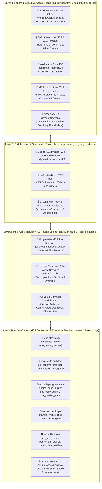

# 🏛️ AI Company OS (v10 ➔ v11) — Complete Architecture Reference & 2026 Industry Standards Blueprint

> **Document Purpose:** This document provides (1) a complete technical reference of everything currently built in **AI Company OS (`v1–v10`)**, how the backend, protocols, tools, and UI work under the hood, and (2) an online-researched blueprint of the **2026 Enterprise Multi-Agent Industry Standards** required to elevate this platform to the next level (**v11**).

---

## PART 1: How AI Company OS Is Currently Built (`v1–v10` Complete Inventory)

### 1.1 High-Level 4-Layer System Architecture

---

### 1.2 Core Codebase File Map

| File | Lines | Responsibility |
| :--- | :--- | :--- |
| [`server/index.js`](file:///C:/Users/laufe/.gemini/antigravity/scratch/ai-company-os/server/index.js) | ~275 | Express HTTP + SSE server (`port 3456`), REST API endpoints, MCP JSON-RPC 2.0 endpoint (`POST /api/mcp`), and Google A2A discovery (`GET /.well-known/agent-card.json`). |
| [`server/company-engine.js`](file:///C:/Users/laufe/.gemini/antigravity/scratch/ai-company-os/server/company-engine.js) | ~2,825 | Stateful autonomous company orchestrator: 4-phase cyclic loop (`strategy ➔ hiring ➔ execution ➔ qa_evolution`), parallel execution (`Promise.allSettled`), HR firing/retraining, CFO MRR & valuation engine, War Room standups, Time-Travel checkpoints, Rival Talent Poaching, and A2A card generation. |
| [`server/tool-executor.js`](file:///C:/Users/laufe/.gemini/antigravity/scratch/ai-company-os/server/tool-executor.js) | ~1,500 | **Model Context Protocol (MCP) Server Hub** (`MCP_SERVERS`), `TOOL_REGISTRY` (11 built-in tools + runtime custom tools), Progressive Tool Discovery (`selectOptimalToolsForTask`), real child-process execution (`execFileSync('node', ['--check'])`), Closed-Loop Self-Healing AST Debugger (`autoHealWorkspaceCode`), and `node:vm` custom tool runner. |
| [`server/llm-router.js`](file:///C:/Users/laufe/.gemini/antigravity/scratch/ai-company-os/server/llm-router.js) | ~485 | Universal multi-provider LLM client with prompt whitespace/boilerplate compression, LRU response caching, token/cost accounting, and a deterministic fallback Simulator (`runSimulator`) that embeds live Mermaid diagrams and YAML contracts. |
| [`public/index.html`](file:///C:/Users/laufe/.gemini/antigravity/scratch/ai-company-os/public/index.html) | ~710 | Zero-build single-page shell loading React 18 UMD, Marked.js, Mermaid.js v10, and Highlight.js (Tokyo Night Dark), plus 8 UI themes (`Classic`, `Cyberpunk`, `Neon`, `Lo-Fi`, `Cute`, `B&W`, `Retro 80s`, `Daylight`) and 7 interactive modals. |
| [`public/virtual-office.js`](file:///C:/Users/laufe/.gemini/antigravity/scratch/ai-company-os/public/virtual-office.js) | ~1,285 | 60fps `requestAnimationFrame` 2.5D SVG Virtual Office floorplan with walking human avatars, orbiting Hermes sub-agent drones, animated courier packets, drag-and-drop department room reassignment, Web Audio API procedural sound effects, and a docked **Live MCP & A2A Terminal Split-Drawer**. |
| [`public/app.js`](file:///C:/Users/laufe/.gemini/antigravity/scratch/ai-company-os/public/app.js) | ~1,880 | React 18 components (`ToolRouterStudioComponent`, `WorkspaceExplorerComponent`, `InteractiveOrgGraphComponent`, `CFOAnalyticsComponent`, `GitHubEcosystemComponent`), SSE stream client, and keyboard shortcuts (`Space`, `W`, `R`, `P`). |

---

### 1.3 Built-In MCP Servers & Executable Tool Registry (`TOOL_REGISTRY`)

Every tool in [`server/tool-executor.js`](file:///C:/Users/laufe/.gemini/antigravity/scratch/ai-company-os/server/tool-executor.js) belongs to one of **5 Bounded-Context MCP Servers**, declares a formal JSON Schema (`inputSchema`), and produces verifiable files in `/workspace`:

| Tool ID | MCP Server | Dept | Real Execution Command & Output Artifact |
| :--- | :--- | :--- | :--- |
| `workspace_coder` | `mcp-filesystem` | Engineering | Synthesizes CommonJS service (`*_service.js`) & runs `node --check` |
| `auto_healer_patcher` | `mcp-filesystem` | Engineering | Scans `/workspace/*.js` & `.json`, captures `stderr`, auto-repairs syntax/AST, writes `SELF_HEAL_REPORT.md` |
| `sql_schema_architect` | `mcp-sqlite-architect` | Engineering | Synthesizes normalized multi-tenant DDL (`*_schema.sql`) with PK/FK & composite indexes |
| `openapi_contract_synth` | `mcp-sqlite-architect` | Engineering | Generates machine-readable OpenAPI 3.1 REST spec (`OPENAPI_SPEC.json`) |
| `unit_test_runner` | `mcp-github-ops` | Engineering | Generates & executes `node:assert` test suite (`*_test.js`) in a child process |
| `benchmark_profiler` | `mcp-github-ops` | Engineering | Runs 500-request stress benchmark (`*_benchmark.json`) measuring P50/P95/P99 latency & RPS |
| `qa_sandbox_verifier` | `mcp-github-ops` | QA | Runs zero-trust syntax & JSON schema verification across all `/workspace` files |
| `landing_page_builder` | `mcp-playwright-auditor` | Marketing | Builds responsive dark-mode HTML5 landing funnel (`*_landing.html`) |
| `seo_copy_auditor` | `mcp-playwright-auditor` | Marketing | Audits HTML DOM for CTA clarity, semantic tags & CVR score (`*_seo_audit.json`) |
| `live_market_intel` | `mcp-playwright-auditor` | Marketing | Queries live HackerNews Algolia API (`hn.algolia.com`) & writes `*_market_intel.json` |
| `financial_monte_carlo` | `mcp-stripe-finops` | Finance | Runs 1,000-trial normal-distribution Monte Carlo simulation (`*_unit_model.json`) |
| `custom_vm_tools (*)` | User-selected | Any | Dynamically registered via `POST /api/tools/create` & executed in isolated `node:vm` (`1500ms` timeout) |

---

## PART 2: Online Research — What 2026 Industry Standards We Still Need to Add

Our research across the 2025–2026 enterprise agent ecosystem (**OpenTelemetry GenAI**, **Mem0 / Letta / Zep Graphiti**, **OWASP Top 10 for Agentic AI (`ASI01–ASI10`)**, **Temporal / LangGraph Durable Execution**, and **SWE-bench / GAIA Evals**) identified **5 critical industry standards** that will transform **AI Company OS** into a true future-standard platform:

### 🌐 Standard 1: OpenTelemetry (OTel) GenAI Distributed Tracing (`gen_ai.*` Semantic Conventions)
- **Industry Standard (Langfuse / Arize Phoenix / OTel GenAI):** Production multi-agent systems no longer rely on flat text logs. Every cycle emits a hierarchical **OpenTelemetry Trace Tree** (`trace_id`, `span_id`, `parent_span_id`) using standard `gen_ai.*` attributes:
  - `gen_ai.operation.name` (`invoke_agent`, `chat`, `execute_tool`, `a2a_handoff`)
  - `gen_ai.provider.name`, `gen_ai.request.model`, `gen_ai.usage.input_tokens`, `gen_ai.usage.output_tokens`
  - `gen_ai.tool.name`, `gen_ai.tool.call.id`, `gen_ai.agent.id`, `gen_ai.agent.name`
- **What We Should Add in v11:**
  - A native **OpenTelemetry GenAI Span Collector & Waterfall Visualizer** (`GET /api/otel/traces` + interactive **📊 OTel Trace Waterfall** UI view) so you can inspect the exact millisecond-by-millisecond flamegraph of `CEO Strategy ➔ Parallel Worker Spans ➔ MCP Tool Spans ➔ A2A Handoff Spans ➔ QA Evaluator Span`.

### 🧠 Standard 2: 4-Tier Cognitive Memory & Temporal Knowledge Graph (Tulving / Mem0 / Letta / Zep Graphiti)
- **Industry Standard:** *"Most multi-agent AI systems fail not because agents can't communicate, but because they can't remember."* Modern cognitive architectures separate memory into 4 explicit tiers:
  1. **Working Memory ($M_w$):** Immediate context window + progressive tool schemas.
  2. **Episodic Memory ($M_e$):** Time-stamped agent experiences (*what failed in Cycle #3 and how it was fixed*).
  3. **Semantic Knowledge Graph ($M_s$ — Zep Graphiti style):** Bi-temporal Entity-Relationship graph (`Entity ➔ Relation ➔ Entity` with `validFrom` timestamps) shared across all departments so Marketing and Finance query live architectural facts rather than stale text.
  4. **Procedural Memory ($M_p$):** Learned `SKILL.md` files, SOPs, and custom VM tools.
- **What We Should Add in v11:**
  - Build a **Bi-Temporal Company Knowledge Graph Engine (`companyKnowledgeGraph`)** that automatically extracts entities and relationships from every task, SQL schema, API contract, and financial model (`e.g., [CorePlatformService] --uses_table--> [tenant_workspaces] --priced_at--> [$149/mo Growth Tier]`) and renders an interactive **🧠 Semantic Knowledge Graph** in the UI.

### 🛡️ Standard 3: OWASP Agentic AI Security Guardrails (`ASI01–ASI10`) & Pre-Action RBAC Policy Engine
- **Industry Standard (OWASP GenAI Top 10 for Agentic Applications):** Prompt filtering alone cannot stop Indirect Prompt Injection (`ASI01: Agent Goal Hijack`), `ASI02: Tool Misuse`, or `ASI05: Unexpected Code Execution`. Security must be enforced **deterministically at the tool boundary** before execution:
  - **Pre-Action RBAC & Least-Privilege Policy Check:** Verify that the calling agent's department and role are authorized to invoke the target MCP server/tool and that arguments match strict bounds.
  - **Prompt-Injection & Exfiltration Firewall:** Scan inputs and tool payloads for shell injection (`rm -rf`, `child_process`, `process.env` leaks, unauthorized external URLs) before any VM or tool executes.
- **What We Should Add in v11:**
  - Add a **Deterministic OWASP Agentic Policy & Guardrail Engine (`server/security-guardrails.js`)** that intercepts every LLM prompt and MCP tool call, logs cryptographic policy verdicts (`ALLOW`, `SANITIZED`, `BLOCKED_RBAC`, `BLOCKED_INJECTION`), and displays a live **🛡️ OWASP ASI01–ASI10 Security Posture Matrix**.

### ⏱️ Standard 4: Durable Cyclic State Machines & Human-in-the-Loop `interrupt()` Gates (Temporal / LangGraph Pattern)
- **Industry Standard:** When an agent hits a high-stakes action (e.g., deploying to production, changing pricing, or exceeding budget), the state machine executes a durable `interrupt()`, persists the exact execution cursor to disk, pauses without burning compute, and resumes seamlessly when the human approves or modifies the state payload.
- **What We Should Add in v11:**
  - Upgrade our pipeline state machine with **Durable `interrupt()` Breakpoints** and an **Event-Sourced Replay Log** so you can pause mid-task, edit an agent's intermediate state variables, and resume execution without losing progress.

### 🧪 Standard 5: Automated Agent Evaluation Harness (SWE-bench / GAIA Style Company Benchmark)
- **Industry Standard:** Top AI labs benchmark agent reliability continuously against reproducible suites (**SWE-bench** for code resolution + self-healing, **GAIA** for multi-tool reasoning and data accuracy).
- **What We Should Add in v11:**
  - Add a 1-click **🏆 Run SWE-Bench & GAIA Company Eval Suite (`POST /api/evals/run`)** that stress-tests your AI Company across 5 standardized tasks (Code Synthesis, Broken AST Self-Healing, SQL Schema Normalization, Monte Carlo Precision, and A2A Handoff Fidelity) and computes a composite **Industry Benchmark Percentile Score (0–100%)**.

---

## PART 3: Proposed v11 Implementation Roadmap

| Phase | Feature | Target Files |
| :--- | :--- | :--- |
| **Phase 29** | **OpenTelemetry (OTel) GenAI Tracer (`gen_ai.*` Spans + Flamegraph UI)** | `server/otel-tracer.js`, `server/company-engine.js`, `public/app.js` |
| **Phase 30** | **4-Tier Cognitive Memory & Bi-Temporal Knowledge Graph (Mem0 / Zep Pattern)** | `server/company-engine.js`, `public/app.js` |
| **Phase 31** | **OWASP Agentic Security Guardrails (`ASI01–ASI10`) & Pre-Action RBAC Engine** | `server/tool-executor.js`, `server/company-engine.js` |
| **Phase 32** | **SWE-Bench & GAIA Automated Multi-Agent Evaluation Suite (`POST /api/evals/run`)** | `server/tool-executor.js`, `server/index.js`, `public/app.js` |
