# ⚡ AI Company OS (v13) — Autonomous Multi-Agent AI Company Platform

[](https://opensource.org/licenses/MIT)
[](https://nodejs.org/)
[-purple)](https://modelcontextprotocol.io/)
[](https://github.com/google)
[](https://owasp.org/)

**AI Company OS (v13)** is a production-grade autonomous multi-agent operating system inspired by **Paperclip**, **NousResearch Hermes-Agent**, **MetaGPT**, **ChatDev**, **OpenHands ACI**, **Browser-Use**, and the **2026 MCP (`2026-07-28`) & Google A2A-1.0** enterprise agent protocols.

Provide a **Company Mission Goal**, and the autonomous executive team (**CEO, CTO, CMO, CFO, HR, QA**) will self-organize, hire specialists, spawn recursive sub-agents, execute executable tools inside isolated sandboxes, write real code into `/workspace`, deploy a live product funnel (`/live-product`), run **Browser-Use visual DOM CRO patches**, speak executive standups via **Voice Walkie-Talkie**, and push live commits to GitHub inside an interactive **60fps 2.5D Animated Virtual Office**.

---

## 🏛️ System Architecture

```mermaid
flowchart TD
    subgraph FOUNDER_LAYER ["Founder Cockpit & Governance"]
        Omni["⌘K Omni-Command Palette"]
        Cinema["🎥 Cinema Camera & Office HUD"]
        Hotline["🎙️ Direct Executive Hotline"]
        HITL["✋ HITL Diff Gate & Counterfactual Editor"]
    end

    subgraph C_SUITE ["Autonomous C-Suite Leadership"]
        CEO["👔 CEO: Strategy & MetaGPT Roadmaps"]
        CTO["🛠️ CTO: Architecture & AST Engine"]
        CMO["📢 CMO: Market Intel & GTM Funnels"]
        CFO["💎 CFO: FinOps, Pricing & Token ROI"]
        HR["🤝 HR: Recruiting, KPI & Sub-Agents"]
        QA["🛡️ QA: OWASP Firewall & Evals"]
    end

    subgraph ENTERPRISE_BUS ["Protocols & Memory Cortex"]
        A2A["🌐 Google A2A-1.0 Directory (.well-known/agent-card.json)"]
        MCP["🔌 Model Context Protocol (5 Bounded Servers)"]
        OTEL["📊 OpenTelemetry GenAI Semantic Spans (gen_ai.*)"]
        KG["🧠 Bi-Temporal Semantic Knowledge Graph (Reflect Loop)"]
        OWASP["🛡️ OWASP ASI01-ASI06 Pre-Action Firewall"]
    end

    subgraph EXECUTION_TIER ["Execution & Product Runtime"]
        Workspace["📂 /workspace (Microservices, SQL DDL, Tests)"]
        AST["🩹 Self-Healing AST Debugger (Closed-Loop)"]
        LiveFunnel["🌐 /live-product (Real HTML + Pricing + Health API)"]
        Traffic["📈 Synthetic Customer Traffic Swarm (+MRR)"]
        LLMs["⚡ Multi-LLM Router (Ollama, Gemini, Claude, OpenAI, Groq)"]
    end

    FOUNDER_LAYER --> C_SUITE
    C_SUITE <--> ENTERPRISE_BUS
    ENTERPRISE_BUS <--> EXECUTION_TIER
```



---

## 🌟 Key Features

### 1. 🏢 60fps Animated Virtual Office & Cinema Camera
* **Living Office Simulation**: Employees walk between 8 functional zones (`C-Suite Penthouse`, `Engineering Lab`, `Marketing Studio`, `FinOps Vault`, `HR Portal`, `Holo-Commons War Room`, `QA Sandbox`, `Server Core`).
* **Realistic Motion Physics**: Stepping walk cycles with swinging feet, directional body facing, running footstep dust, desk typing sparks, and dynamic blinking eye visors.
* **🎥 Cinema Camera Zoom**: Click any department chip (`[ 🛠️ Engineering Lab ]`, `[ 🏛️ War Room ]`) or click a room on the floorplan to smoothly swoop the camera in at 60fps.
* **Streaming Neural Conduits**: Glowing animated energy pulses flow through hallway buses toward the central commons.
* **Drag-and-Drop Reassignment**: Drag agents between rooms to reassign departments, into the HR lab for training (`+5% KPI`), or into the Exit Airlock to fire and auto-replace.

### 2. 🎙️ Direct Executive Hotline Terminal
* Click any agent in the office or org chart to open their **Executive Hotline**.
* Dispatch direct natural language orders with instant AI execution.
* **One-Click Directive Chips**:
  * `⚡ Top Priorities` — Audits the agent's current top 3 mission goals.
  * `🔍 Audit Code` — Commands the agent to review and auto-optimize `/workspace` code.
  * `⇄ Plan Handoff` — Directs a cross-department task handoff.
  * `🏆 Rival Strategy` — Generates a competitive battle plan against rival startups.
* Live responses immediately trigger speech bubbles above the agent's head on the office floor.

### 3. ⌘K Omni-Command Palette
* Press **`Ctrl+K`** or **`Cmd+K`** anywhere to summon the command center.
* Real-time fuzzy filtering across all pipeline commands, executive standups, Red Team audits, evaluation benchmarks, and individual agent brains.
* Full keyboard arrow navigation (`↑`, `↓`, `Enter`, `Esc`).

### 4. 🧠 Bi-Temporal Semantic Knowledge Graph
* Visual interactive force-directed SVG knowledge graph explorer based on the **Mem0 / Zep Graphiti** pattern.
* Continuously distills episodic event logs into validated `(Subject, Predicate, Object)` semantic triples via the autonomous **"Reflect"** cognitive loop.
* Pulsing node halos, streaming edge energy animations, and temporal provenance inspection.

### 5. 🌐 Live Product Runtime Split-Screen (`/live-product`)
* The agents don't just write specs — they build, test, and host an actual product live inside the OS.
* **Live Product Drawer**: Embeds `/live-product`, serving the actual generated HTML landing page, pricing models, and real-time backend endpoints (`/live-product/api/health`, `/live-product/api/pricing`).
* **Customer Traffic Swarm Simulator**: Fire simulated HTTP request swarms (P50/P99 latency benchmarks) to convert real visitors into active **Monthly Recurring Revenue (MRR)**.

### 6. ✋ Human-in-the-Loop (HITL) Diff Gate & Counterfactual State Editor
* Review every code deliverable in a colorized, side-by-side diff viewer (`- [BASELINE SPEC]` vs `+ [AGENT OUTPUT]`).
* **Counterfactual State Editing**: Rewrite deliverables, alter status, or inject prompt modifications mid-flight before committing, allowing LangGraph-style time-travel branching without restarting runs.

### 7. 🛡️ Enterprise Protocols & Security
* **OWASP Agentic Top 10 Firewall**: Validates all tool calls against `ASI01` (Prompt Injection), `ASI02` (Unauthorized Tool Execution), `ASI05` (Insecure Output Handling), and `ASI06` (Excessive Agency).
* **Google Agent2Agent (A2A-1.0)**: Automatically publishes standards-compliant agent cards at `/.well-known/agent-card.json`.
* **Model Context Protocol (MCP `2026-07-28` Spec + "MCP Apps" & MRTR)**: 5 stateless bounded MCP servers (`mcp-filesystem`, `mcp-sqlite-architect`, `mcp-playwright-auditor`, `mcp-stripe-finops`, `mcp-github-ops`) with inline interactive **MCP App UIs** (`mcp.apps/render`) and **Multi Round-Trip Requests (`input_required`)**.
* **SWE-Bench & GAIA Benchmark Harness**: 5-trial multi-agent evaluation suite auditing AST repair, OpenAPI contract alignment, FinOps Monte Carlo models, and A2A SLAs.
* **OpenTelemetry GenAI Tracing**: Full OpenTelemetry span collector supporting `gen_ai.system`, `gen_ai.request.model`, and token usage telemetry.

### 8. 🚀 2026 Frontier Agentic Upgrades (v13)
* **🎙️ Real-Time Voice Walkie-Talkie & Spoken C-Suite Standups**: Bi-directional voice command channel (`SpeechRecognition` push-to-talk + `speechSynthesis` executive voice synthesis) with live equalizer waveform and spoken War Room standups.
* **🧩 Interactive "MCP Apps" & Multi Round-Trip (`MRTR`) Widgets**: Live FinOps Seat ARPU & ARR simulator slider and MRTR CTA approval gates rendered directly inside the MCP terminal stream.
* **🖥️ "Browser-Use" Visual DOM & Computer-Use Agent**: Overlays numbered visual DOM bounding boxes (`[1]`–`[5]`) and an autonomous scanning AI cursor over `/live-product`, executing automated CRO patches that boost conversion rates and MRR.
* **📊 2D Competitor Market Radar & FinOps Burn-vs-MRR Chart**: Interactive SVG bubble radar (Feature Velocity vs. Market Share) and CFO cash runway trajectory with one-click competitive blitz maneuvers.
* **🐙 OpenHands / SWE-Agent ACI Studio & Live GitHub Auto-Push**: Stage, commit, and push generated `/workspace` microservices and telemetry directly to `github.com/omer12619/ai-company-os` from the UI.

---

## ⚡ Supported LLM Providers

| Provider | Type | Recommended Model | Highlights |
| :--- | :--- | :--- | :--- |
| **Ollama (Local GPU)** | Local | `qwen2.5-coder:7b` | **100% Free**, zero rate limits, runs entirely in 8GB VRAM (e.g. RTX 4060 Ti) |
| **Google Gemini** | Cloud | `gemini-3.8-flash` / `2.5-flash` | Generous free tier, 1M context window, high speed |
| **Anthropic Claude** | Cloud | `claude-3-7-sonnet-latest` | Best-in-class multi-agent reasoning and coding |
| **OpenAI** | Cloud | `gpt-4o` / `gpt-4o-mini` | High reliability and structured JSON outputs |
| **Groq LPU** | Cloud | `llama-3.3-70b-versatile` | Ultra-fast 500+ tok/s inference |
| **OpenRouter** | Cloud | `qwen/qwen-2.5-coder-32b-instruct:free` | Unified access to free & premium models |
| **Autonomous Simulator** | Built-in | `simulator-v2` | Zero API key required; instant out-of-the-box local simulation |

---

## 🚀 Quick Start

### Prerequisites
* [Node.js](https://nodejs.org/) v18.0.0 or higher
* (Optional) [Ollama](https://ollama.com/) for 100% free local GPU inference:
  ```powershell
  ollama run qwen2.5-coder:7b
  ```

### Installation
```bash
# Clone the repository
git clone https://github.com/omer12619/ai-company-os.git
cd ai-company-os

# Install dependencies
npm install

# Start the OS server
npm start
```

Open your browser at:
```
http://localhost:3456
```

---

## ⌨️ Founder Keyboard Shortcuts

| Shortcut | Action | Description |
| :--- | :--- | :--- |
| **`Ctrl + K`** / **`⌘K`** | **Omni-Command Palette** | Global search and trigger for any action, agent, or tool |
| **`Space`** | **Step Pipeline** | Execute 1 single cycle of the autonomous company |
| **`W`** | **Executive War Room** | Call a C-Suite emergency standup around the Holo-Table |
| **`R`** | **Red Team Security Audit** | Probe and auto-harden all `/workspace` code files |
| **`P`** | **Poach Rival Star** | Poach a 95% KPI talent from rival startups (+4.5% market share) |

---

## 📂 Project Structure

```
ai-company-os/
├── server/
│   ├── index.js                  # Express API server & REST / MCP endpoints
│   ├── company-engine.js         # Autonomous company state machine & lifecycle
│   ├── tool-executor.js          # Sandbox tool runner, OWASP firewall & evals
│   └── llm-router.js             # Universal multi-provider LLM router & cache
├── public/
│   ├── index.html                # Main OS dashboard, modals & HUD layouts
│   ├── styles.css                # Futuristic themes, spring physics & keyframes
│   ├── app.js                    # Core frontend client, Omni-palette & graph
│   └── virtual-office.js         # React + SVG 60fps 2.5D virtual office
├── workspace/                    # Generated microservices, tests, SQL & landing funnels
└── data/
    └── company-state.json        # Persistent company state & snapshot ledger
```

---

## 📄 License

MIT © [omer12619](https://github.com/omer12619)
